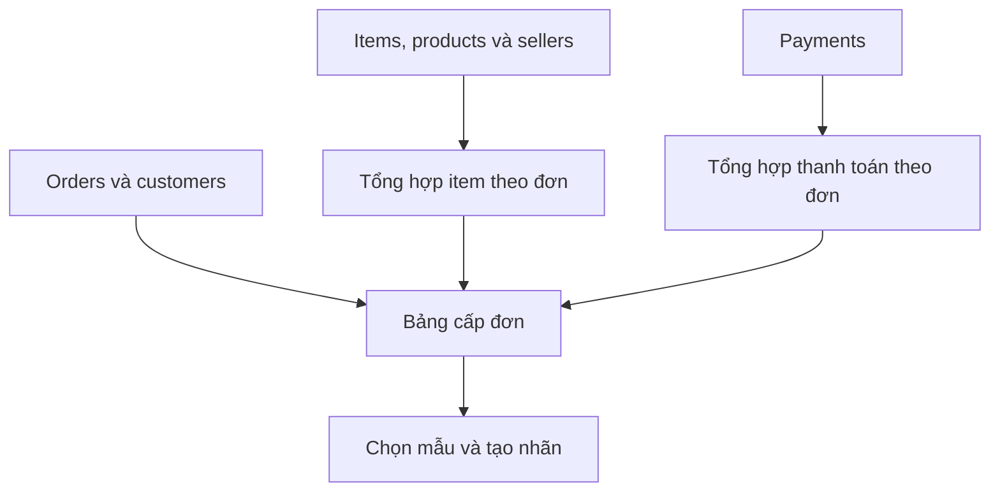

# PHỤ LỤC CHƯƠNG 3. KIỂM TRA DỮ LIỆU VÀ SCHEMA

Quay lại [Chương 3](CH03_DATA.md).

## A. Kiểm tra chất lượng 9 bảng

**Bảng PL3.1. Số dòng, ô thiếu và cờ kiểm tra trước và sau xử lý**

| Bảng | Dòng gốc | Dòng sau xử lý | Dòng loại | Ô thiếu gốc | Ô thiếu sau xử lý | Số cột cờ | Dòng có cờ |
| --- | --- | --- | --- | --- | --- | --- | --- |
| Đơn hàng | 99.441 | 99.441 | 0 | 4.908 | 4.908 | 7 | 1.382 |
| Chi tiết đơn | 112.650 | 112.650 | 0 | 0 | 0 | 4 | 0 |
| Khách hàng | 99.441 | 99.441 | 0 | 0 | 0 | 2 | 0 |
| Người bán | 3.095 | 3.095 | 0 | 0 | 0 | 2 | 0 |
| Sản phẩm | 32.951 | 32.951 | 0 | 2.448 | 2.452 | 8 | 614 |
| Thanh toán | 103.886 | 103.886 | 0 | 0 | 0 | 7 | 11 |
| Đánh giá | 99.224 | 99.224 | 0 | 145.903 | 145.932 | 2 | 0 |
| Địa lý | 1.000.163 | 738.332 | 261.831 | 0 | 0 | 4 | 33 |
| Dịch danh mục | 71 | 71 | 0 | 0 | 0 | 1 | 0 |

*Nguồn: Nhóm tính từ 9 CSV của Olist [1]. Ô thiếu sau xử lý được tính trên các cột gốc.*

**Bảng PL3.2. Kiểm tra khóa ngoại**

| Bảng con | Khóa | Bảng cha | Thiếu khóa | Dòng mồ côi |
| --- | --- | --- | --- | --- |
| orders | customer_id | customers | 0 | 0 |
| items | order_id | orders | 0 | 0 |
| items | product_id | products | 0 | 0 |
| items | seller_id | sellers | 0 | 0 |
| payments | order_id | orders | 0 | 0 |
| reviews | order_id | orders | 0 | 0 |

**Bảng PL3.3. Đối soát khi tổng hợp về cấp đơn**

| Chỉ tiêu | Trước | Sau | Chênh lệch |
| --- | --- | --- | --- |
| total_price | 13591643.7 | 13591643.7 | 0.0 |
| total_freight | 2251909.54 | 2251909.54 | 0.0 |
| total_payment | 16008872.12 | 16008872.12 | 0.0 |
| item_count | 112650.0 | 112650.0 | 0.0 |

[Xem nhật ký làm sạch](../tables/cleaning_log.csv) · [Kiểm tra khóa nối](../tables/join_audit.csv) · [Đối chiếu quan hệ](../tables/cardinality_audit.csv) · [Hồ sơ từng cột gốc](../tables/raw_column_profile.csv) · [Từ điển dữ liệu](../tables/data_dictionary.csv)

### Luồng tích hợp dữ liệu

Nhóm tổng hợp items và payments riêng trước khi nối. Ví dụ, một đơn có 3 dòng item và 2 dòng thanh toán có thể thành 6 dòng nếu nối trực tiếp theo order_id. Sau khi tổng hợp, mỗi bảng đưa tối đa một dòng của đơn vào phép nối. Geolocation theo ZIP, bản dịch danh mục và đánh giá được xử lý thành các bảng tra cứu hoặc phân tích riêng.

**Bảng PL3.4. Số đơn theo từng bước tích hợp**

| Bước | Số dòng |
| --- | --- |
| Orders ban đầu | 99.441 |
| Nối khách hàng | 99.441 |
| Nối chi tiết đơn đã tổng hợp | 99.441 |
| Nối thanh toán đã tổng hợp | 99.441 |

[Thống kê giá, phí và khối lượng](../tables/eda_numeric_overview.csv)

## B. Vai trò của 37 cột dữ liệu cấp đơn

**Bảng PL3.5. Danh mục cột trong orders_model_ready.csv**

| Cột | Vai trò | Nguồn | Ý nghĩa | Dùng trong X |
| --- | --- | --- | --- | --- |
| order_id | Metadata | orders | Khóa đối soát, không làm X | Không |
| customer_id | Metadata | orders/customers | Khóa liên kết, không làm X | Không |
| order_status | Thông tin hậu nghiệm | orders | Trạng thái cuối dùng chọn mẫu | Không |
| order_purchase_timestamp | Metadata | orders | Nguồn tạo các feature thời gian | Không |
| order_approved_at | Metadata | orders | Mốc t0 và chia tập thời gian | Không |
| order_delivered_carrier_date | Thông tin hậu nghiệm | orders | Mốc sau phê duyệt | Không |
| order_delivered_customer_date | Thông tin hậu nghiệm | orders | Chỉ tạo nhãn và kiểm tra nhãn đủ chín | Không |
| order_estimated_delivery_date | Chưa xác minh tại lúc duyệt | orders | Dùng tạo nhãn; nếu làm feature phải chứng minh có tại t0 | Không |
| qa_unknown_status | Cờ hoặc số liệu QA | orders | Cờ QA; có thể dùng thời gian tương lai, không làm X | Không |
| qa_approved_before_purchase | Cờ hoặc số liệu QA | orders | Cờ QA; có thể dùng thời gian tương lai, không làm X | Không |
| qa_carrier_before_approved | Cờ hoặc số liệu QA | orders | Cờ QA; có thể dùng thời gian tương lai, không làm X | Không |
| qa_delivery_before_carrier | Cờ hoặc số liệu QA | orders | Cờ QA; có thể dùng thời gian tương lai, không làm X | Không |
| qa_delivery_before_approved | Cờ hoặc số liệu QA | orders | Cờ QA; có thể dùng thời gian tương lai, không làm X | Không |
| qa_delivery_before_purchase | Cờ hoặc số liệu QA | orders | Cờ QA; có thể dùng thời gian tương lai, không làm X | Không |
| qa_estimate_before_purchase | Cờ hoặc số liệu QA | orders | Cờ QA; có thể dùng thời gian tương lai, không làm X | Không |
| customer_state | Đặc trưng cơ sở | customers | Bang khách tại lúc đặt/duyệt | Có |
| item_count | Chưa xác minh tại lúc duyệt | order_items | Số dòng item/đơn | Không |
| product_count | Chưa xác minh tại lúc duyệt | order_items | Số product_id khác nhau/đơn | Không |
| seller_count | Chưa xác minh tại lúc duyệt | order_items | Số seller_id khác nhau/đơn | Không |
| total_price | Chưa xác minh tại lúc duyệt | order_items | Tổng price, BRL; không bao gồm freight | Không |
| total_freight | Chưa xác minh tại lúc duyệt | order_items | Tổng freight_value, BRL | Không |
| price_known_items | Cờ hoặc số liệu QA | order_items | Số item có giá | Không |
| freight_known_items | Cờ hoặc số liệu QA | order_items | Số item có phí | Không |
| avg_weight_g | Chưa xác minh tại lúc duyệt | products + items | Trung bình gram/item có số đo, không phải tổng kiện | Không |
| weight_known_items | Cờ hoặc số liệu QA | products + items | Số item có khối lượng | Không |
| seller_region | Chưa xác minh tại lúc duyệt | sellers + items | Một bang hoặc MULTI nếu nhiều bang | Không |
| product_category | Chưa xác minh tại lúc duyệt | products + items | Một category hoặc MULTI nếu nhiều category | Không |
| total_payment | Chưa xác minh tại lúc duyệt | payments | Tổng thanh toán theo đơn | Không |
| payment_records | Chưa xác minh tại lúc duyệt | payments | Số bản ghi thanh toán theo đơn | Không |
| is_late | Nhãn | orders | DATE(actual)>DATE(estimated), chỉ delivered đủ ngày | Không |
| purchase_month | Chỉ dùng cho EDA | orders | Tháng YYYY-MM để vẽ EDA | Không |
| order_value_group | Chỉ dùng cho EDA | items | Nhóm total_price dùng cho EDA | Không |
| weight_group | Chỉ dùng cho EDA | products + items | Nhóm avg_weight_g dùng cho EDA | Không |
| purchase_month_number | Đặc trưng cơ sở | orders | Tháng đặt hàng, 1–12 | Có |
| purchase_weekday | Đặc trưng cơ sở | orders | Thứ đặt hàng, 0=thứ Hai, 6=Chủ nhật | Có |
| purchase_hour | Đặc trưng cơ sở | orders | Giờ đặt hàng, 0–23 | Có |
| approval_delay_hours | Đặc trưng cơ sở | orders | (approved - purchase), giờ | Có |

*Nguồn: Nhóm xây dựng từ Olist [1]. Cột “Dùng trong X” chỉ có 5 giá trị “Có”.*

[Schema dạng CSV](../tables/model_data_schema.csv) · [Danh mục đặc trưng](../tables/feature_registry.csv) · [SHA256 của dữ liệu gốc](../tables/source_manifest.csv) · [Kiểm tra đầu ra](../tables/final_validation.csv)

[1] Olist. *Brazilian E-Commerce Public Dataset by Olist*. Kaggle. https://www.kaggle.com/datasets/olistbr/brazilian-ecommerce (truy cập ngày 13/11/2026).
