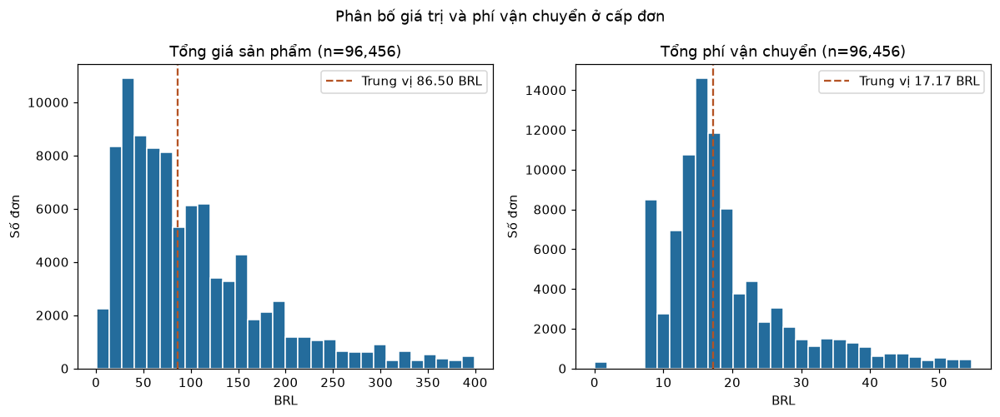

# CHƯƠNG 3. DỮ LIỆU VÀ PHƯƠNG PHÁP XỬ LÝ

Người thực hiện: Lam Linh · Nhóm 02

## 3.1. Nguồn và cấu trúc dữ liệu

Nhóm sử dụng 9 tệp CSV của Brazilian E-Commerce Public Dataset by Olist [1]. Dữ liệu mô tả đơn hàng tại Brazil giai đoạn 2016–2018. Trang Kaggle công bố giấy phép CC BY-NC-SA 4.0. Nhóm giữ nguyên dữ liệu gốc và lưu SHA256 của từng tệp để đối chiếu phiên bản.

Tải bộ Olist từ Kaggle [1] và giải nén 9 CSV vào `data/raw/`. Nếu đã cài Git LFS, có thể lấy các tệp có sẵn trên `main`. Xem [hướng dẫn tải dữ liệu](../../data/README.md).

**Bảng 3.1. Kích thước và chất lượng dữ liệu gốc**

| Bảng | Số dòng | Số cột | Dòng trùng | Ô thiếu |
| --- | --- | --- | --- | --- |
| Đơn hàng | 99.441 | 8 | 0 | 4.908 |
| Chi tiết đơn | 112.650 | 7 | 0 | 0 |
| Khách hàng | 99.441 | 5 | 0 | 0 |
| Người bán | 3.095 | 4 | 0 | 0 |
| Sản phẩm | 32.951 | 9 | 0 | 2.448 |
| Thanh toán | 103.886 | 5 | 0 | 0 |
| Đánh giá | 99.224 | 7 | 0 | 145.903 |
| Địa lý | 1.000.163 | 5 | 261.831 | 0 |
| Dịch danh mục | 71 | 2 | 0 | 0 |

*Nguồn: Nhóm tính từ 9 CSV của Olist [1].*

*Hình 3.1. ERD do Lam Linh trình bày bằng draw.io. Xem [tệp sơ đồ](../diagrams/ERD.drawio).*

Bảng orders là trung tâm. Olist cấp một customer_id riêng cho từng đơn, nên quan hệ quan sát qua customer_id là 1:1. Một người mua vẫn có thể đặt nhiều đơn và được nhận diện qua customer_unique_id. Items và payments có thể có nhiều dòng cho một đơn. Nhóm kiểm tra khóa ghép review_id và order_id ở bảng reviews. Geolocation có nhiều dòng trên một tiền tố ZIP nên nhóm dùng bảng tọa độ đại diện khi tra cứu.

## 3.2. Tích hợp và làm sạch

Nhóm chuẩn hóa chuỗi, mã ZIP, ngày và số, sau đó kiểm tra khóa và ghi cờ các giá trị bất thường. Ngày giao bị thiếu được giữ nguyên để áp dụng quy tắc chọn mẫu. Nhóm giữ đánh giá thiếu bình luận vì trường điểm vẫn có thể dùng để phân tích hậu giao.

**Bảng 3.2. Các vấn đề chính khi làm sạch dữ liệu**

| Vấn đề | Kết quả xử lý |
| --- | --- |
| Dòng trùng ở bảng địa lý | Bỏ 261.831 dòng trùng hoàn toàn. Còn 738.332 dòng. |
| Trọng lượng sản phẩm | Chuyển 4 giá trị không hợp lệ thành thiếu và giữ giá trị gốc để đối chiếu. |
| Bình luận đánh giá | Chuẩn hóa chuỗi trắng thành thiếu. Số ô thiếu tăng từ 145.903 lên 145.932. |
| Mốc thời gian đơn hàng | Gắn cờ 1.382 dòng có ít nhất một dấu hiệu bất thường. Giữ nguyên timestamp. |
| Khóa ngoại | 6 liên kết đã kiểm tra có 0 khóa thiếu và 0 dòng mồ côi. |

*Nguồn: Nhóm tính từ Olist [1]. Chi tiết ở [Phụ lục Chương 3](CH03_APPENDIX.md).*

Nhóm nối items với products và sellers, rồi tổng hợp theo order_id. Payments được tổng hợp riêng. Hai bảng tổng hợp mới được nối với orders. Số dòng trước và sau khi nối đều là 99.441, mỗi order_id xuất hiện đúng một lần. Tổng tiền sản phẩm, phí vận chuyển, thanh toán và số item đều khớp khi đối soát.

## 3.3. Nhãn và chọn mẫu

Với đơn `delivered` có đủ thời điểm duyệt, ngày giao thực tế và ngày giao dự kiến, `is_late` bằng 1 nếu ngày giao thực tế sau ngày giao dự kiến. Giao trong ngày dự kiến được tính là đúng hạn. Đơn ngoài điều kiện nằm ngoài tập có nhãn.

**Bảng 3.3. Số đơn bị loại theo từng bước**

| Lý do | Số đơn |
| --- | --- |
| Đơn chưa giao thành công | 2.963 |
| Thiếu thời điểm duyệt | 14 |
| Thiếu thời điểm giao thực tế | 8 |
| Thiếu ngày giao dự kiến | 0 |

*Nguồn: Nhóm tính từ bảng đơn hàng Olist [1]. Các lý do được áp dụng theo thứ tự trong bảng.*

Tập chính có 96,456 đơn, trong đó 6,534 đơn trễ (6.77%). Các lý do loại được áp dụng tuần tự. Mẫu chỉ đại diện cho đơn delivered đủ ngày. Nhóm giữ các đơn có cờ thời gian nếu đáp ứng quy tắc gán nhãn, vì thiếu nhật ký nghiệp vụ để xác minh nguyên nhân hoặc hiệu chỉnh timestamp. Khi loại 1,373 đơn có ít nhất một cờ thời gian, tập còn 95,083 đơn và tỷ lệ trễ là 6.85%, chênh 0.07 điểm phần trăm. Các mốc bất thường, nhất là ngày giao trước thời điểm duyệt, có thể ảnh hưởng đến kiểm tra thời điểm nhãn hình thành và kết quả đánh giá. Phép kiểm tra trên chỉ đo tỷ lệ trễ. Khi đánh giá độ nhạy của mô hình, cần chạy lại cách chia tập và đối chiếu chỉ số trên mẫu đã loại cờ. Ngày giao thực tế và các cờ dùng dữ liệu tương lai được giữ ngoài X.

| Tập đối chiếu | Số đơn | Tỷ lệ trễ |
| --- | --- | --- |
| Tập chính | 96.456 | 6,77% |
| Bỏ đơn có ít nhất một cờ thời gian | 95.083 | 6,85% |

## 3.4. Phân tích khám phá

Các tỷ lệ dưới đây được tính trên 96.456 đơn delivered đủ nhãn. Nhóm đọc tỷ lệ cùng cỡ mẫu của từng nhóm.

### Theo tháng

*Hình 3.3. Theo tháng. Nguồn: Nhóm tính từ Olist [1].*

Trong các tháng có ít nhất 1.000 đơn (ngưỡng chỉ để đọc EDA), tháng 2018-03 có tỷ lệ trễ cao nhất: 18.96% trên 7,003 đơn; tháng 2018-06 là 1.16% trên 6,096 đơn. Những tháng đầu/cuối ít dữ liệu vẫn được giữ trên hình nhưng không dùng riêng để kết luận mùa vụ. Biến động này gợi ý cần đánh giá mô hình theo thời gian, thay vì chỉ chia ngẫu nhiên.

### Bang khách hàng

*Hình 3.4. Bang khách hàng. Nguồn: Nhóm tính từ Olist [1].*

SP: 40,489 đơn, trễ 4.50%; RJ: 12,348 đơn, trễ 12.11%; BA: 3,256 đơn, trễ 12.16%. SP có nhiều đơn nhưng không phải bang có tỷ lệ trễ cao nhất. Khác biệt giữa các bang đáng để xem xét trong bài toán dự báo, nhưng biểu đồ chưa chứng minh địa lý là nguyên nhân gây trễ. customer_state được sử dụng trong baseline vì thông tin này có từ lúc đặt hàng.

### Bang người bán

*Hình 3.5. Bang người bán. Nguồn: Nhóm tính từ Olist [1].*

SP: 68,190 đơn, trễ 7.35%; PR: 7,345 đơn, trễ 5.47%; MG: 7,566 đơn, trễ 4.89%; MULTI: 509 đơn, trễ 0.59%. MULTI là đơn có seller ở nhiều bang; nhiều seller cùng bang vẫn nằm trong bang đó. Vì vậy không đồng nhất nhóm này với toàn bộ đơn nhiều người bán. Các tỷ lệ là mô tả, chưa tách riêng ảnh hưởng của tuyến giao hàng hay loại sản phẩm. Thuộc tính seller không nằm trong baseline vì chưa có bằng chứng về thời điểm gán seller trong dữ liệu snapshot.

### Danh mục sản phẩm

*Hình 3.6. Danh mục sản phẩm. Nguồn: Nhóm tính từ Olist [1].*

cama_mesa_banho: 9,074 đơn, trễ 7.54%; beleza_saude: 8,578 đơn, trễ 7.55%; esporte_lazer: 7,460 đơn, trễ 6.61%; informatica_acessorios: 6,479 đơn, trễ 6.44%. Đơn có nhiều danh mục được gắn MULTI; thiếu toàn bộ danh mục được gắn UNKNOWN. Đây là phân nhóm ở cấp đơn, không phải số lượng sản phẩm bán ra. Chênh lệch tỷ lệ trễ giữa các danh mục chưa chứng minh tác động riêng của loại hàng, nên biến này chỉ được dùng cho EDA trong phạm vi nghiên cứu hiện tại.

### Giá trị sản phẩm trong đơn

*Hình 3.7. Giá trị sản phẩm trong đơn. Nguồn: Nhóm tính từ Olist [1].*

<=50 BRL: 29,040 đơn, trễ 6.03%; 50-100 BRL: 27,601 đơn, trễ 6.66%; 100-200 BRL: 25,280 đơn, trễ 7.12%; 200-500 BRL: 11,058 đơn, trễ 7.81%; >500 BRL: 3,477 đơn, trễ 8.08%. Các khoảng được hiểu là (50,100], (100,200], (200,500]; nhóm đầu gồm giá trị ≤50. total_price là tổng giá sản phẩm, chưa gồm phí vận chuyển, không đồng nghĩa tổng thanh toán. Trên mẫu đang xét, tỷ lệ trễ tăng theo các nhóm giá; đây là liên hệ mô tả, chưa thể kết luận đơn đắt hơn gây giao trễ.

### Phân bố giá sản phẩm và phí vận chuyển

*Hình 3.8. Phân bố giá sản phẩm và phí vận chuyển. Nguồn: Nhóm tính từ Olist [1].*

Tổng giá sản phẩm có trung vị 86.50 BRL, trung bình 137.04 BRL và phân vị 95% là 399.00 BRL. Tổng phí vận chuyển có trung vị 17.17 BRL, trung bình 22.79 BRL và phân vị 95% là 54.78 BRL. Hình hiển thị giá trị đến phân vị 95% để nhìn rõ vùng tập trung. Bảng thống kê sử dụng toàn bộ số liệu có giá trị, kể cả các đơn ở phần đuôi.

### Khối lượng trung bình theo item

*Hình 3.9. Khối lượng trung bình theo item. Nguồn: Nhóm tính từ Olist [1].*

<=500g: 40,772 đơn, trễ 6.44%; 500-1000g: 17,191 đơn, trễ 6.31%; 1000-5000g: 26,494 đơn, trễ 7.08%; >5000g: 11,977 đơn, trễ 7.92%; Thiếu khối lượng: 22 đơn, trễ 0.00%. avg_weight_g là trung bình khối lượng của các item có số đo, không phải tổng khối lượng kiện hàng. weight_known_items cho biết số item có thông tin để tránh xem trung bình thiếu dữ liệu là đầy đủ. Không điền khối lượng thiếu bằng 0; nhóm thiếu được trình bày riêng. Kết quả chưa tách tác động của khoảng cách giao hàng và danh mục sản phẩm.

### Mã người bán

| Mã người bán | Số đơn | Số đơn trễ | Tỷ lệ trễ |
| --- | --- | --- | --- |
| 6560211a19b47992c3666cc44a7e94c0 | 1819 | 96 | 5,28% |
| 4a3ca9315b744ce9f8e9374361493884 | 1772 | 172 | 9,71% |
| cc419e0650a3c5ba77189a1882b7556a | 1651 | 87 | 5,27% |
| 1f50f920176fa81dab994f9023523100 | 1399 | 124 | 8,86% |
| da8622b14eb17ae2831f4ac5b9dab84a | 1311 | 87 | 6,64% |
| 955fee9216a65b617aa5c0531780ce60 | 1261 | 77 | 6,11% |
| 7a67c85e85bb2ce8582c35f2203ad736 | 1142 | 60 | 5,25% |
| ea8482cd71df3c1969d7b9473ff13abc | 1132 | 96 | 8,48% |
| 4869f7a5dfa277a7dca6462dcf3b52b2 | 1124 | 118 | 10,50% |
| 3d871de0142ce09b7081e2b9d1733cb1 | 1064 | 58 | 5,45% |

Bảng trên là 10 seller có nhiều đơn được gán nhãn nhất, không phải bảng xếp hạng chất lượng người bán. Một đơn nhiều seller được tính một lần trong từng seller liên quan, nên tổng số đơn giữa các seller có thể lớn hơn tổng đơn toàn bộ. Tỷ lệ trễ dựa vào kết quả giao của cả đơn; chưa đủ căn cứ quy trách nhiệm cho từng seller. Cách đếm ở bảng này là cơ sở để giữ nhất quán các lát cắt theo seller khi phân tích lỗi ở Chương 5.

### Bốn phát hiện liên quan đến Chương 4

1. Lớp giao trễ chiếm **6,77%**. Dummy là mốc tham chiếu. Chương 4 theo dõi AP, Precision và Recall để đánh giá khả năng phát hiện đơn trễ.
2. Trong các tháng có từ 1.000 đơn, tháng 2018-03 có tỷ lệ trễ **18,96%** và tháng 2018-06 là **1,16%**. Biến động này là lý do để kiểm tra mô hình trên các giai đoạn sau thời điểm huấn luyện.
3. Tỷ lệ trễ của khách ở SP là **4,50%**, còn RJ là **12,11%**. Bang nhận hàng có sẵn tại thời điểm phê duyệt và được đưa vào bộ đặc trưng cơ sở.
4. Các nhóm giá và người bán có tỷ lệ trễ khác nhau trong mẫu. Nhóm dùng chúng để đặt câu hỏi cho phân tích lỗi. Muốn dùng chúng làm đầu vào ở Chương 4 cần xác minh thời điểm có dữ liệu.

## 3.5. Đặc trưng và kiểm soát rò rỉ thông tin

Dự báo được thực hiện tại `order_approved_at`. Bảng dữ liệu cấp đơn có 37 cột để phục vụ huấn luyện, chia tập và đối soát. Chương 4 lấy đúng 5 cột đầu vào theo danh sách dưới đây.

**Bảng 3.4. Năm đặc trưng dùng tại thời điểm phê duyệt**

| Đặc trưng | Cách xác định tại lúc duyệt |
| --- | --- |
| purchase_month_number | Tháng đặt hàng, từ 1 đến 12 |
| purchase_weekday | Thứ đặt hàng, từ 0 (thứ Hai) đến 6 (Chủ nhật) |
| purchase_hour | Giờ đặt hàng, từ 0 đến 23 |
| approval_delay_hours | Số giờ từ lúc đặt đến lúc đơn được phê duyệt |
| customer_state | Bang nhận hàng của khách, nối qua customer_id |

*Nguồn: Nhóm xây dựng từ bảng orders và customers của Olist [1].*

| Nhóm cột khác | Mục đích sử dụng |
|---|---|
| Nhãn | is_late là biến đích y. |
| Khóa, thời điểm và cờ QA | Đối soát từng đơn và kiểm tra chia tập. Ngày giao thực tế dùng để kiểm tra nhãn đã hình thành trước cutoff. |
| Thông tin hậu nghiệm | Trạng thái cuối, ngày giao vận và đánh giá phục vụ tạo nhãn, chọn mẫu hoặc phân tích hồi cứu. |
| Thông tin chỉ dùng trong EDA hoặc chưa rõ tại lúc duyệt | Giá, phí, số item, thuộc tính người bán và sản phẩm, thanh toán và ngày giao dự kiến. |

Xem toàn bộ vai trò các cột ở [Phụ lục Chương 3](CH03_APPENDIX.md). Notebook 04 đọc `orders_model_ready.csv` để chia tập và lấy X theo danh sách đặc trưng. Imputer, encoder và scaler được fit trên tập Train.

### Kết luận chương

Nhóm đã tích hợp 9 bảng Olist và thu được 96.456 đơn có nhãn, trong đó 6.534 đơn giao trễ (6,77%). Các bảng QA giúp truy lại những thay đổi trong quá trình làm sạch. Kết quả mô tả tập đơn delivered đủ nhãn tại Brazil giai đoạn 2016–2018. Tỷ lệ trễ và chất lượng các mốc thời gian cần được kiểm tra lại khi mở rộng phạm vi áp dụng.

## Tài liệu tham khảo

[1] Olist. *Brazilian E-Commerce Public Dataset by Olist*. Kaggle. https://www.kaggle.com/datasets/olistbr/brazilian-ecommerce (truy cập ngày 13/11/2026).
