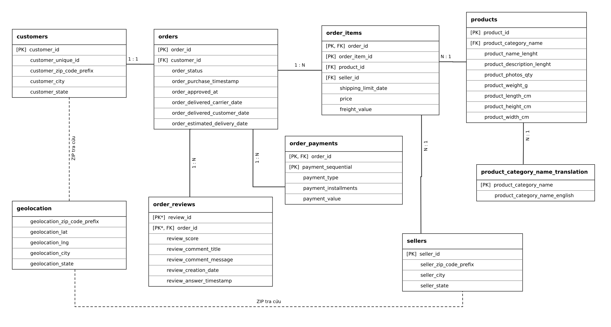
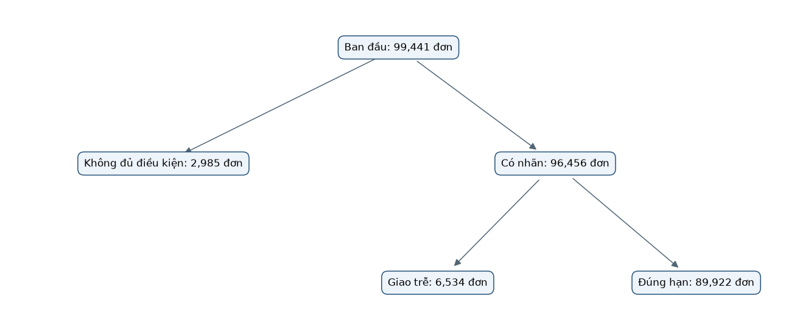
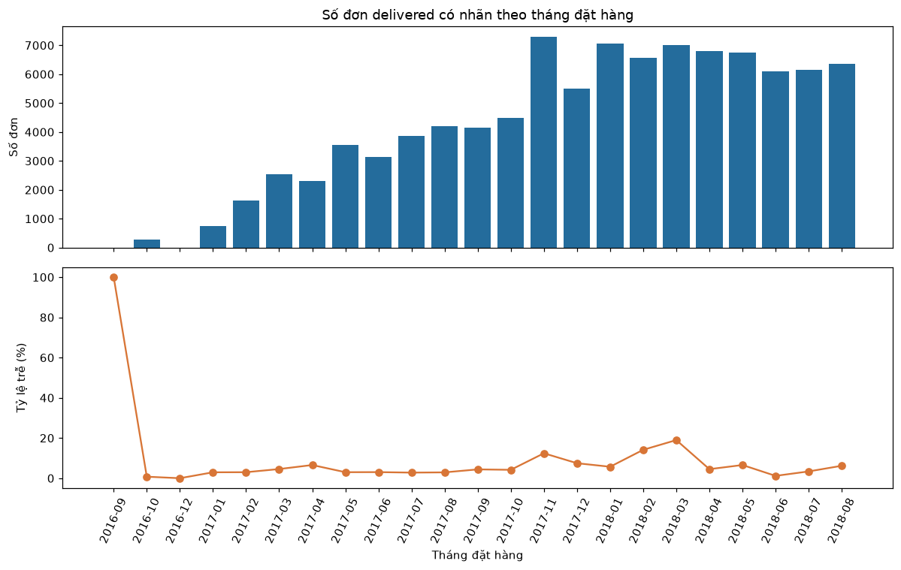
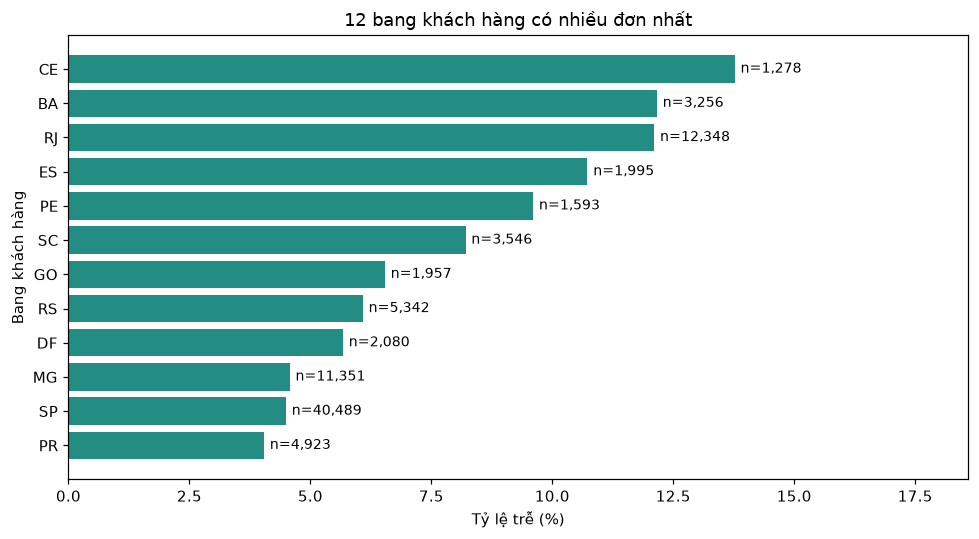
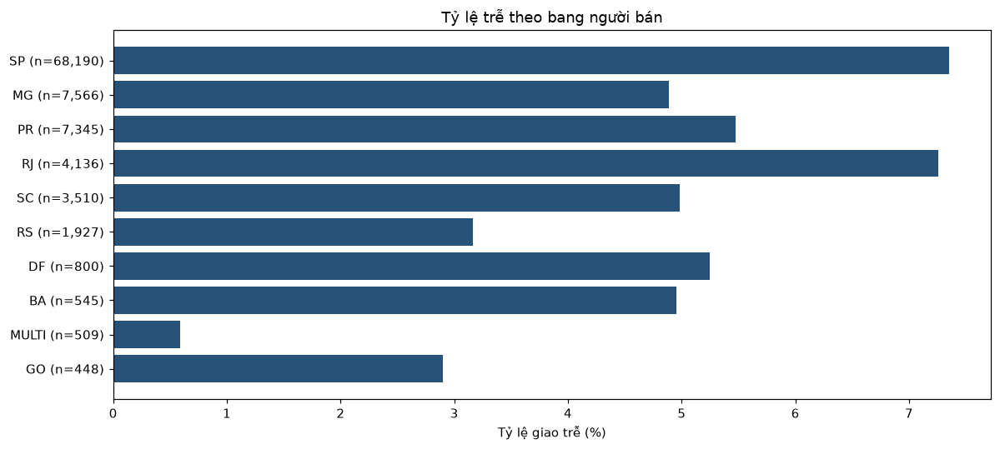
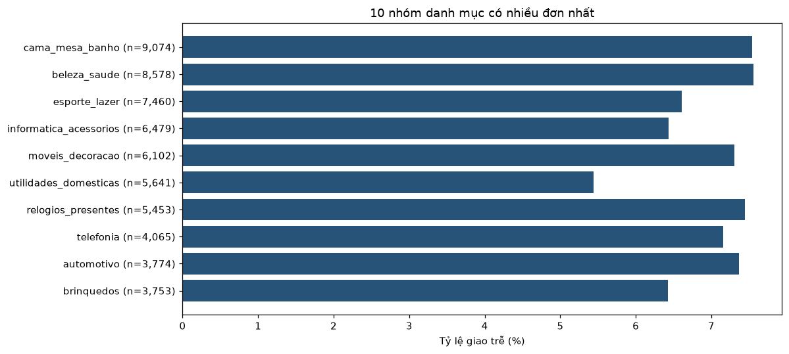
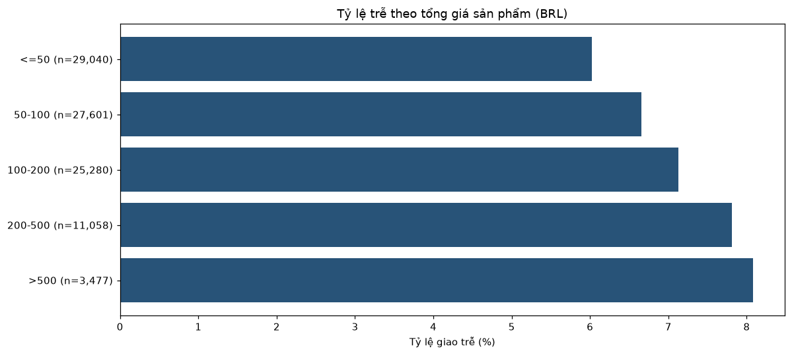
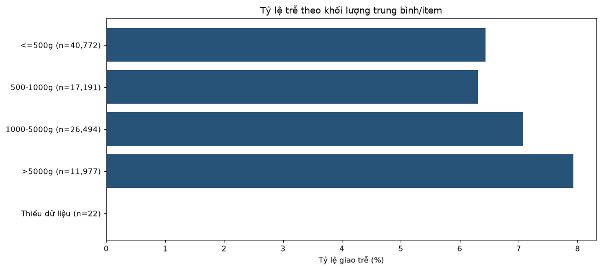

# CHƯƠNG 3. DỮ LIỆU VÀ PHƯƠNG PHÁP XỬ LÝ

Người thực hiện: Lam Linh — Nhóm 02.

## 3.1. Nguồn và cấu trúc dữ liệu

Nghiên cứu sử dụng 9 CSV của Brazilian E-Commerce Public Dataset by Olist [1], phản ánh đơn hàng tại Brazil giai đoạn 2016–2018. Giấy phép công bố trên trang nguồn là CC BY-NC-SA 4.0. Dữ liệu raw được giữ nguyên, mỗi tệp có mã SHA256 để đối chiếu. Khi tải repository dùng Git LFS, chạy git lfs install và git lfs pull để lấy đủ CSV.

| table | rows | columns | duplicate_rows | missing_cells |
| --- | --- | --- | --- | --- |
| orders | 99441 | 8 | 0 | 4908 |
| items | 112650 | 7 | 0 | 0 |
| customers | 99441 | 5 | 0 | 0 |
| sellers | 3095 | 4 | 0 | 0 |
| products | 32951 | 9 | 0 | 2448 |
| payments | 103886 | 5 | 0 | 0 |
| reviews | 99224 | 7 | 0 | 145903 |
| geolocation | 1000163 | 5 | 261831 | 0 |
| translation | 71 | 2 | 0 | 0 |

Orders là bảng trung tâm; items và payments cần tổng hợp trước khi nối. Một người mua có thể đặt nhiều đơn, nhưng customer_id trong Olist gắn riêng từng đơn; customer_unique_id nhận diện người mua lặp. Vì vậy, phép nối theo customer_id quan sát là 1:1. Reviews kiểm tra khóa ghép review_id/order_id. Geo được tổng hợp theo ZIP, translation có danh mục chưa khớp.

## 3.2. Tích hợp và làm sạch

Các bước xử lý gồm chuẩn hóa chuỗi, mã ZIP, kiểu ngày và số, loại dòng trùng hoàn toàn, kiểm tra khóa và gắn cờ QA. Ngày giao thiếu không được điền giả; đánh giá không bị xóa chỉ vì thiếu bình luận. Trọng lượng không hợp lệ được chuyển thành thiếu, giữ giá trị gốc để đối chiếu.

| table | rows_before | rows_after | removed_rows | missing_before | missing_after_original_columns | qa_flag_columns | rows_with_any_qa_flag |
| --- | --- | --- | --- | --- | --- | --- | --- |
| orders | 99441 | 99441 | 0 | 4908 | 4908 | 7 | 1382 |
| items | 112650 | 112650 | 0 | 0 | 0 | 4 | 0 |
| customers | 99441 | 99441 | 0 | 0 | 0 | 2 | 0 |
| sellers | 3095 | 3095 | 0 | 0 | 0 | 2 | 0 |
| products | 32951 | 32951 | 0 | 2448 | 2452 | 8 | 614 |
| payments | 103886 | 103886 | 0 | 0 | 0 | 7 | 11 |
| reviews | 99224 | 99224 | 0 | 145903 | 145932 | 2 | 0 |
| geolocation | 1000163 | 738332 | 261831 | 0 | 0 | 4 | 33 |
| translation | 71 | 71 | 0 | 0 | 0 | 1 | 0 |

| child | key | parent | missing_key | orphan_rows |
| --- | --- | --- | --- | --- |
| orders | customer_id | customers | 0 | 0 |
| items | order_id | orders | 0 | 0 |
| items | product_id | products | 0 | 0 |
| items | seller_id | sellers | 0 | 0 |
| payments | order_id | orders | 0 | 0 |
| reviews | order_id | orders | 0 | 0 |

Geolocation giảm số dòng do bỏ trùng. Missing của reviews tăng khi chuẩn hóa chuỗi trắng; missing của products tăng khi chuyển số đo không hợp lệ thành NaN. Số dòng có cờ QA đếm mỗi dòng tối đa một lần. Các cờ không đồng nghĩa mọi bản ghi đó đều sai hoặc đã được sửa.

Mỗi order_id có đúng một dòng sau tích hợp. Items được nối sản phẩm/người bán và tổng hợp theo đơn; payments được tổng hợp riêng. Cardinality và tổng tiền được đối soát trước/sau join.

| metric | count |
| --- | --- |
| orders_before_join | 99441 |
| orders_after_join | 99441 |
| orders_without_items | 775 |
| orders_without_payment | 1 |
| orders_with_multiple_sellers | 1278 |

| metric | before | after | difference |
| --- | --- | --- | --- |
| total_price | 13591643.7 | 13591643.7 | 0.0 |
| total_freight | 2251909.54 | 2251909.54 | 0.0 |
| total_payment | 16008872.12 | 16008872.12 | 0.0 |
| item_count | 112650.0 | 112650.0 | 0.0 |

## 3.3. Nhãn và chọn mẫu

is_late=1 nếu DATE(ngày giao thực tế)>DATE(ngày giao dự kiến), ngược lại bằng 0. Chỉ gán nhãn cho delivered có đủ ngày duyệt, ngày giao và ngày dự kiến; đơn chưa đủ điều kiện không được gán nhãn 0.

| reason | excluded_orders |
| --- | --- |
| not_delivered | 2963 |
| missing_approved_at | 14 |
| missing_actual_delivery | 8 |
| missing_estimated_delivery | 0 |

Tập phân tích gồm 96,456 đơn, trong đó 6,534 đơn giao trễ (6.77%). Các lý do loại được áp dụng tuần tự nên không đếm trùng một đơn. Tập này chỉ phản ánh đơn delivered đủ dữ liệu, không đại diện cho đơn hủy hoặc đang giao. Mẫu chính giữ các bản ghi có cờ thời gian để bảo toàn quy tắc chọn mẫu; không sửa hoặc suy đoán lại timestamp. Khi loại toàn bộ đơn có ít nhất một cờ thời gian, số mẫu và tỷ lệ trễ thay đổi như bảng kiểm tra độ nhạy. Đây là giới hạn chất lượng timestamp của nghiên cứu, đặc biệt với các đơn có ngày giao trước thời điểm duyệt. Bảng độ nhạy chỉ mô tả ảnh hưởng đến tỷ lệ trễ, không chứng minh những bản ghi này không ảnh hưởng đến kết quả mô hình. Ở bước chia tập theo thời gian, ngày giao thực tế được dùng kiểm tra nhãn đã hình thành trước cutoff và không được đưa vào X.

| cohort | orders | late_rate |
| --- | --- | --- |
| main_contract | 96456 | 0.067741 |
| exclude_any_chronology_flag_for_review | 95083 | 0.068466 |

## 3.4. Phân tích khám phá

EDA mô tả tập delivered có nhãn. Các kết quả được đọc cùng cỡ mẫu và không được diễn giải như quan hệ nhân quả hoặc kết quả đánh giá mô hình.

### Theo tháng

Trong các tháng có ít nhất 1.000 đơn (ngưỡng chỉ để đọc EDA), tháng 2018-03 có tỷ lệ trễ cao nhất: 18.96% trên 7,003 đơn; tháng 2018-06 là 1.16% trên 6,096 đơn. Những tháng đầu/cuối ít dữ liệu vẫn được giữ trên hình nhưng không dùng riêng để kết luận mùa vụ. Biến động này gợi ý cần đánh giá mô hình theo thời gian, thay vì chỉ chia ngẫu nhiên.

### Bang khách hàng

SP: 40,489 đơn, trễ 4.50%; RJ: 12,348 đơn, trễ 12.11%; BA: 3,256 đơn, trễ 12.16%. SP có nhiều đơn nhưng không phải bang có tỷ lệ trễ cao nhất. Khác biệt giữa các bang đáng để xem xét trong bài toán dự báo, nhưng biểu đồ chưa chứng minh địa lý là nguyên nhân gây trễ. customer_state được sử dụng trong baseline vì thông tin này có từ lúc đặt hàng.

### Bang người bán

SP: 68,190 đơn, trễ 7.35%; PR: 7,345 đơn, trễ 5.47%; MG: 7,566 đơn, trễ 4.89%; MULTI: 509 đơn, trễ 0.59%. MULTI là đơn có seller ở nhiều bang; nhiều seller cùng bang vẫn nằm trong bang đó. Vì vậy không đồng nhất nhóm này với toàn bộ đơn nhiều người bán. Các tỷ lệ là mô tả, chưa tách riêng ảnh hưởng của tuyến giao hàng hay loại sản phẩm. Thuộc tính seller không nằm trong baseline vì chưa có bằng chứng về thời điểm gán seller trong dữ liệu snapshot.

### Danh mục

cama_mesa_banho: 9,074 đơn, trễ 7.54%; beleza_saude: 8,578 đơn, trễ 7.55%; esporte_lazer: 7,460 đơn, trễ 6.61%; informatica_acessorios: 6,479 đơn, trễ 6.44%. Đơn có nhiều danh mục được gắn MULTI; thiếu toàn bộ danh mục được gắn UNKNOWN. Đây là phân nhóm ở cấp đơn, không phải số lượng sản phẩm bán ra. Chênh lệch tỷ lệ trễ giữa các danh mục chưa chứng minh tác động riêng của loại hàng, nên biến này chỉ được dùng cho EDA trong phạm vi nghiên cứu hiện tại.

### Giá trị đơn

<=50 BRL: 29,040 đơn, trễ 6.03%; 50-100 BRL: 27,601 đơn, trễ 6.66%; 100-200 BRL: 25,280 đơn, trễ 7.12%; 200-500 BRL: 11,058 đơn, trễ 7.81%; >500 BRL: 3,477 đơn, trễ 8.08%. Các khoảng được hiểu là (50,100], (100,200], (200,500]; nhóm đầu gồm giá trị ≤50. total_price là tổng giá sản phẩm, chưa gồm phí vận chuyển, không đồng nghĩa tổng thanh toán. Trên mẫu đang xét, tỷ lệ trễ tăng theo các nhóm giá; đây là liên hệ mô tả, chưa thể kết luận đơn đắt hơn gây giao trễ.

### Khối lượng

<=500g: 40,772 đơn, trễ 6.44%; 500-1000g: 17,191 đơn, trễ 6.31%; 1000-5000g: 26,494 đơn, trễ 7.08%; >5000g: 11,977 đơn, trễ 7.92%; Thiếu khối lượng: 22 đơn, trễ 0.00%. avg_weight_g là trung bình khối lượng của các item có số đo, không phải tổng khối lượng kiện hàng. weight_known_items cho biết số item có thông tin để tránh xem trung bình thiếu dữ liệu là đầy đủ. Không điền khối lượng thiếu bằng 0; nhóm thiếu được trình bày riêng. Kết quả chưa tách tác động của khoảng cách giao hàng và danh mục sản phẩm.

### Mã người bán

| seller_id | orders | late_orders | late_rate |
| --- | --- | --- | --- |
| 6560211a19b47992c3666cc44a7e94c0 | 1819 | 96 | 0.052776 |
| 4a3ca9315b744ce9f8e9374361493884 | 1772 | 172 | 0.097065 |
| cc419e0650a3c5ba77189a1882b7556a | 1651 | 87 | 0.052695 |
| 1f50f920176fa81dab994f9023523100 | 1399 | 124 | 0.088635 |
| da8622b14eb17ae2831f4ac5b9dab84a | 1311 | 87 | 0.066362 |
| 955fee9216a65b617aa5c0531780ce60 | 1261 | 77 | 0.061063 |
| 7a67c85e85bb2ce8582c35f2203ad736 | 1142 | 60 | 0.052539 |
| ea8482cd71df3c1969d7b9473ff13abc | 1132 | 96 | 0.084806 |
| 4869f7a5dfa277a7dca6462dcf3b52b2 | 1124 | 118 | 0.104982 |
| 3d871de0142ce09b7081e2b9d1733cb1 | 1064 | 58 | 0.054511 |

Bảng trên là 10 seller có nhiều đơn được gán nhãn nhất, không phải bảng xếp hạng chất lượng người bán. Một đơn nhiều seller được tính một lần trong từng seller liên quan, nên tổng số đơn giữa các seller có thể lớn hơn tổng đơn toàn bộ. Tỷ lệ trễ dựa vào kết quả giao của cả đơn; chưa đủ căn cứ quy trách nhiệm cho từng seller. Cách đếm ở bảng này là cơ sở để giữ nhất quán các lát cắt theo seller khi phân tích lỗi ở Chương 5.

## 3.5. Đặc trưng và kiểm soát rò rỉ thông tin

Tập có nhãn gồm 37 cột phục vụ các vai trò khác nhau. X chỉ gồm 5 feature baseline trong whitelist. orders_baseline_input.csv chứa khóa đơn, nhãn và 5 feature; metadata chia tập nằm ở tệp riêng.

| column | role | source | meaning | use_in_X |
| --- | --- | --- | --- | --- |
| order_id | metadata | orders | Khóa đối soát, không làm X | False |
| customer_id | metadata | orders/customers | Khóa liên kết, không làm X | False |
| order_status | forbidden_feature | orders | Trạng thái cuối dùng chọn mẫu | False |
| order_purchase_timestamp | metadata | orders | Nguồn tạo các feature thời gian | False |
| order_approved_at | metadata | orders | Mốc t0 và chia tập thời gian | False |
| order_delivered_carrier_date | forbidden_feature | orders | Mốc sau phê duyệt | False |
| order_delivered_customer_date | forbidden_feature | orders | Chỉ tạo nhãn và kiểm tra nhãn đủ chín | False |
| order_estimated_delivery_date | excluded_unverified | orders | Dùng tạo nhãn; nếu làm feature phải chứng minh có tại t0 | False |
| qa_unknown_status | qa_metadata | orders | Cờ QA; có thể dùng thời gian tương lai, không làm X | False |
| qa_approved_before_purchase | qa_metadata | orders | Cờ QA; có thể dùng thời gian tương lai, không làm X | False |
| qa_carrier_before_approved | qa_metadata | orders | Cờ QA; có thể dùng thời gian tương lai, không làm X | False |
| qa_delivery_before_carrier | qa_metadata | orders | Cờ QA; có thể dùng thời gian tương lai, không làm X | False |
| qa_delivery_before_approved | qa_metadata | orders | Cờ QA; có thể dùng thời gian tương lai, không làm X | False |
| qa_delivery_before_purchase | qa_metadata | orders | Cờ QA; có thể dùng thời gian tương lai, không làm X | False |
| qa_estimate_before_purchase | qa_metadata | orders | Cờ QA; có thể dùng thời gian tương lai, không làm X | False |
| customer_state | baseline_feature | customers | Bang khách tại lúc đặt/duyệt | True |
| item_count | excluded_unverified | order_items | Số dòng item/đơn | False |
| product_count | excluded_unverified | order_items | Số product_id khác nhau/đơn | False |
| seller_count | excluded_unverified | order_items | Số seller_id khác nhau/đơn | False |
| total_price | excluded_unverified | order_items | Tổng price, BRL; không bao gồm freight | False |
| total_freight | excluded_unverified | order_items | Tổng freight_value, BRL | False |
| price_known_items | qa_metadata | order_items | Số item có giá | False |
| freight_known_items | qa_metadata | order_items | Số item có phí | False |
| avg_weight_g | excluded_unverified | products + items | Trung bình gram/item có số đo, không phải tổng kiện | False |
| weight_known_items | qa_metadata | products + items | Số item có khối lượng | False |
| seller_region | excluded_unverified | sellers + items | Một bang hoặc MULTI nếu nhiều bang | False |
| product_category | excluded_unverified | products + items | Một category hoặc MULTI nếu nhiều category | False |
| total_payment | excluded_unverified | payments | Tổng thanh toán theo đơn | False |
| payment_records | excluded_unverified | payments | Số bản ghi thanh toán theo đơn | False |
| is_late | target | orders | DATE(actual)>DATE(estimated), chỉ delivered đủ ngày | False |
| purchase_month | eda_only | orders | Tháng YYYY-MM để vẽ EDA | False |
| order_value_group | eda_only | items | Nhóm total_price dùng cho EDA | False |
| weight_group | eda_only | products + items | Nhóm avg_weight_g dùng cho EDA | False |
| purchase_month_number | baseline_feature | orders | Tháng đặt hàng, 1–12 | True |
| purchase_weekday | baseline_feature | orders | Thứ đặt hàng, 0=thứ Hai, 6=Chủ nhật | True |
| purchase_hour | baseline_feature | orders | Giờ đặt hàng, 0–23 | True |
| approval_delay_hours | baseline_feature | orders | (approved - purchase), giờ | True |

Ngày giao thực tế chỉ tạo nhãn/kiểm tra nhãn trước cutoff. Carrier date, trạng thái cuối, review_score và cờ dùng thông tin tương lai không làm feature. Thuộc tính chưa rõ thời điểm xuất hiện chỉ dùng cho EDA. Imputer, encoder và scaler được fit trên Train ở bước huấn luyện.

### Kết luận chương

Chín bảng dữ liệu đã được chuẩn hóa và kiểm tra, tạo được 96.456 đơn có nhãn, trong đó 6.534 đơn giao trễ (6,77%). EDA cho thấy tỷ lệ trễ khác nhau theo thời gian, bang khách hàng và nhóm giá trị đơn. Giới hạn chính là mẫu chỉ gồm delivered đủ nhãn và còn những timestamp bất thường được ghi cờ. Các kết quả không đại diện cho toàn bộ đơn đang vận hành hoặc thị trường Việt Nam.

## Tài liệu tham khảo

[1] Olist. Brazilian E-Commerce Public Dataset by Olist. Kaggle. https://www.kaggle.com/datasets/olistbr/brazilian-ecommerce (truy cập 07/11/2026).
