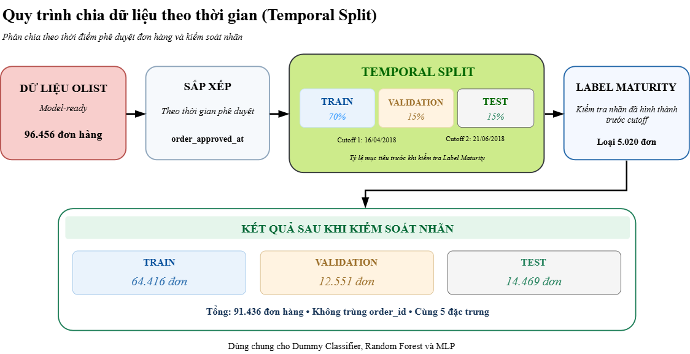

# CH04 MODELING

**Phụ trách:** Trúc Chi.
**Trạng thái báo cáo Chương 4:** Đang hoàn thiện `reports/chapters/CH04_MODELING.md`, bao gồm các mục 4.1–4.6.

## 4.1 Quy trình đánh giá theo thời gian
### 4.1.1. Phương pháp chia dữ liệu Train/Validation/Test

Trong bài toán dự đoán nguy cơ giao hàng trễ, dữ liệu đơn hàng được hình thành và cập nhật theo thời gian. Do đó, việc phân chia dữ liệu cần đảm bảo tính tuần tự nhằm phản ánh đúng điều kiện vận hành thực tế, trong đó mô hình được huấn luyện trên các đơn hàng trong quá khứ và sử dụng để dự đoán những đơn hàng phát sinh sau đó.

Đề tài áp dụng phương pháp chia dữ liệu theo thời gian (*Temporal Split*) thay vì chia ngẫu nhiên. Phương pháp này giúp hạn chế nguy cơ rò rỉ dữ liệu (*Data Leakage*), đồng thời đảm bảo dữ liệu huấn luyện không chứa các đơn hàng xuất hiện sau thời điểm đánh giá.

Dữ liệu đầu vào sau quá trình tiền xử lý gồm **96.456 đơn hàng**, được tổ chức theo từng mã đơn hàng `order_id`. Quá trình phân chia dựa trên thời điểm phê duyệt đơn hàng `order_approved_at`. Các đơn hàng được sắp xếp theo thứ tự thời gian tăng dần trước khi chia thành ba tập dữ liệu.

Theo cấu hình thực nghiệm, dữ liệu ban đầu được phân chia theo tỷ lệ **70% Train, 15% Validation và 15% Test**. Tỷ lệ trên được áp dụng trước khi kiểm soát *Label Maturity*. Vì vậy, số lượng mẫu thực tế của các tập Train và Validation có thể giảm sau quá trình lọc.

Mỗi tập đảm nhận một vai trò riêng:

- **Tập Train:** Sử dụng để huấn luyện mô hình và xác định các tham số tiền xử lý.
- **Tập Validation:** Sử dụng để đánh giá, điều chỉnh siêu tham số và lựa chọn ngưỡng phân loại.
- **Tập Test:** Được giữ độc lập để đánh giá khả năng tổng quát hóa của mô hình sau khi hoàn tất quá trình lựa chọn.

Sau khi phân chia, dữ liệu tiếp tục được kiểm tra điều kiện quan sát nhãn nhằm đảm bảo tính hợp lệ tại từng thời điểm đánh giá.

*Hình 4.1.1. Quy trình phân chia dữ liệu theo thời gian (Temporal Split).*

| Tập dữ liệu | Số đơn hàng | Mục đích sử dụng |
|---|---:|---|
| Train | 64.416 | Huấn luyện mô hình |
| Validation | 12.551 | Đánh giá và lựa chọn mô hình |
| Test | 14.469 | Đánh giá cuối cùng |
| **Tổng cộng** | **91.436** | |

*Bảng 4.1.1. Kết quả phân chia dữ liệu Train/Validation/Test.*

Kết quả cho thấy 91.436 đơn hàng đáp ứng các điều kiện sử dụng sau khi áp dụng quy trình chia dữ liệu theo thời gian và kiểm soát tính hợp lệ của nhãn. Số lượng mẫu giữa các tập có sự chênh lệch do quá trình loại bỏ những đơn hàng chưa đáp ứng điều kiện quan sát nhãn tại các mốc thời gian tương ứng.

Việc phân chia này tạo cơ sở để các mô hình Dummy Classifier, Random Forest và MLP được huấn luyện và đánh giá trên cùng một bộ dữ liệu, đảm bảo tính thống nhất trong quá trình thực nghiệm.

### 4.1.2. Xác định Cutoff và kiểm soát Label Maturity

#### 4.1.2.1. Xác định các mốc thời gian Cutoff

Trong quá trình chia dữ liệu theo thời gian, nhóm sử dụng các mốc Cutoff để xác định ranh giới giữa tập Train, Validation và Test. Các mốc này được xác định tự động dựa trên thời điểm phê duyệt đơn hàng (`order_approved_at`) trong bộ dữ liệu Olist.

Cụ thể, sau khi sắp xếp 96.456 đơn hàng theo thời gian tăng dần, nhóm xác định hai vị trí phân chia tương ứng với 70% và 85% tổng số mẫu. Thời điểm phê duyệt sớm nhất của tập Validation và tập Test lần lượt được chọn làm hai mốc Cutoff.

Kết quả thực nghiệm xác định được các mốc thời gian như sau:

| Mốc thời gian | Giá trị Cutoff | Ý nghĩa |
|---|---|---|
| *Cutoff 1* | 16/04/2018 09:31:24 | Thời điểm bắt đầu Validation |
| *Cutoff 2* | 21/06/2018 12:41:03 | Thời điểm bắt đầu Test |

*Bảng 4.1.2.1. Các mốc thời gian Cutoff trong quá trình thực nghiệm.*

Hai mốc Cutoff phản ánh ranh giới thời gian của các đơn hàng trong dữ liệu lịch sử Olist giai đoạn 2016–2018, không phụ thuộc vào thời điểm thực hiện đồ án.

#### 4.1.2.2. Kiểm soát Label Maturity

Kiểm soát Label Maturity (nhãn đã hình thành) nhằm đảm bảo kết quả giao hàng thực tế đã được biết tại thời điểm sử dụng dữ liệu để huấn luyện hoặc lựa chọn mô hình.

Đối với bài toán phân loại nguy cơ giao hàng trễ, nhãn `is_late` được xác định bằng cách so sánh ngày giao thực tế với ngày giao dự kiến. Tuy nhiên, tại một thời điểm nhất định, những đơn hàng chưa được giao sẽ chưa có kết quả cuối cùng để xác định nhãn.

Do đó, đề tài áp dụng hai điều kiện:

- **Tập Train:** Chỉ giữ lại các đơn hàng có thời điểm giao thực tế (`order_delivered_customer_date`) trước Cutoff 1.
- **Tập Validation:** Chỉ giữ lại các đơn hàng có thời điểm giao thực tế (`order_delivered_customer_date`) trước Cutoff 2.

Tập Test được giữ riêng để phục vụ đánh giá cuối cùng, không sử dụng để lựa chọn mô hình hoặc điều chỉnh ngưỡng phân loại.

**Kết quả kiểm soát Label Maturity:**

Từ 67.519 đơn hàng thuộc tập Train ban đầu, có 3.103 đơn bị loại do thời điểm giao thực tế không trước Cutoff 1, còn lại 64.416 đơn.

Tương tự, tập Validation ban đầu có 14.468 đơn, trong đó 1.917 đơn bị loại do thời điểm giao thực tế không trước Cutoff 2, còn lại 12.551 đơn.

Như vậy, có tổng cộng **5.020 đơn hàng** được loại khỏi hai tập Train và Validation do chưa đáp ứng điều kiện Label Maturity tại các thời điểm tương ứng.

Việc kiểm soát Label Maturity giúp hạn chế nguy cơ rò rỉ thông tin tương lai (*Data Leakage*), đảm bảo mô hình chỉ được huấn luyện hoặc lựa chọn dựa trên những kết quả giao hàng đã hình thành tại thời điểm tương ứng.

### 4.1.3. Cấu hình thực nghiệm và kiểm tra tính nhất quán

Sau khi hoàn tất quá trình chia dữ liệu theo thời gian và kiểm soát Label Maturity, nhóm thống nhất cấu hình thực nghiệm để đảm bảo tính nhất quán và khả năng tái lập kết quả giữa các mô hình Dummy Classifier, Random Forest và MLP.

Đối với các mô hình có yếu tố ngẫu nhiên như Random Forest và MLP, nhóm sử dụng tham số `random_state = 42` (Seed) để kiểm soát các quá trình ngẫu nhiên trong quá trình huấn luyện. Riêng phương pháp Temporal Split không sử dụng Seed do dữ liệu được sắp xếp và phân chia theo thứ tự thời điểm phê duyệt đơn hàng (`order_approved_at`) và mã đơn hàng (`order_id`), thay vì thực hiện chia ngẫu nhiên.

Nhóm sử dụng *Split ID* để xác định bộ dữ liệu chia chung. Mã này được tạo dựa trên thông tin cấu hình, bao gồm mã SHA256 của dữ liệu, danh sách đặc trưng, các mốc Cutoff và số lượng mẫu. Đồng thời, thông tin cấu hình được lưu trong tệp `split_metadata.json`, còn danh sách đơn hàng thuộc từng tập được lưu trong tệp `split_manifest.csv`.

| Thành phần | Giá trị |
|---|---|
| Phương pháp chia | Temporal Split |
| Seed (RF và MLP) | 42 |
| Split ID | `72c64fdd7b6de725a531` |
| Phiên bản giao thức | `gr02-temporal-v2` |
| Số đặc trưng | 5 |
| Kiểm tra dữ liệu | SHA256 |
| Tệp lưu thông tin | `split_metadata.json`, `split_manifest.csv` |

*Bảng 4.1.3. Cấu hình thực nghiệm chung.*

Để đảm bảo tính công bằng trong quá trình so sánh, nhóm thống nhất sử dụng năm đặc trưng đầu vào đã được kiểm tra tính hợp lệ tại thời điểm phê duyệt đơn hàng. Các mô hình sử dụng chung năm đặc trưng đầu vào gồm: `purchase_month_number`, `purchase_weekday`, `purchase_hour`, `approval_delay_hours` và `customer_state`.

Ngoài ra, nhóm tiến hành kiểm tra tính duy nhất của `order_id`, số lượng mẫu và thông tin metadata nhằm đảm bảo các tập Train, Validation và Test không bị trùng lặp, đồng thời thống nhất với cấu hình đã thiết lập.

Việc sử dụng chung *Split ID* và danh sách đặc trưng giúp đảm bảo tính nhất quán, công bằng khi so sánh các mô hình và hỗ trợ tái lập kết quả thực nghiệm.

## 4.2 Tiền xử lý và Dummy

*TODO:* Mục tiêu – phương pháp – bằng chứng (bảng/hình/nguồn) – nhận xét. Chỉ điền số liệu thực đã kiểm chứng.

## 4.3 Tiếp nhận, kiểm chứng Random Forest của Ngọc Lan

*TODO:* Mục tiêu – phương pháp – bằng chứng (bảng/hình/nguồn) – nhận xét. Chỉ điền số liệu thực đã kiểm chứng.

## 4.4 Huấn luyện MLP

*TODO:* Mục tiêu – phương pháp – bằng chứng (bảng/hình/nguồn) – nhận xét. Chỉ điền số liệu thực đã kiểm chứng.

## 4.5 Lựa chọn ngưỡng / Top-K

*TODO:* Mục tiêu – phương pháp – bằng chứng (bảng/hình/nguồn) – nhận xét. Chỉ điền số liệu thực đã kiểm chứng.

> Đồng bộ số liệu, tên biến và trích dẫn với phần triển khai / notebook liên quan trước khi tạo PR.

**Phân công thực nghiệm mới:** Trúc Chi sở hữu split Train/Validation/Test chung; huấn luyện Dummy/MLP. Riêng Random Forest đã được Ngọc Lan fit ở Chương 2, Trúc Chi chỉ kiểm tra và tích hợp `ngoc_lan_random_forest.joblib` theo `split_id` chung. Mục 4.5 lựa chọn champion và ngưỡng trên Validation, không fit RF lần hai. Bàn giao frozen Test cho Vĩnh Chi.

### Phân công huấn luyện mới cho 4.4
**Tấn Lên (TV1)** trực tiếp huấn luyện MLP trong notebook 01 và bàn giao `tan_len_mlp.joblib`, `mlp_val_predictions.csv`, `mlp_metadata.json`. **Trúc Chi (TV4)** chỉ fit Dummy, kiểm chứng RF Ngọc Lan/MLP Tấn Lên và trình bày RF ở 4.3, MLP ở 4.4 dựa trên artifact có `split_id` chung. Chương 4 không có lệnh fit MLP/RF; chỉ tích hợp và xuất frozen Test. Chưa điền số liệu giả.
